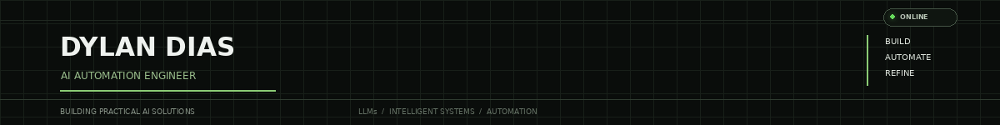

  

<h1 align="center">Dylan Dias</h1>

  <strong>AI Automation Engineer</strong> 
  Building practical applications with data, software, and AI.

---

## About

I build applications, automate workflows, and explore practical ways to apply artificial intelligence to real-world problems.

I'm interested in the engineering behind useful AI products — from connecting LLMs to applications and APIs to building data-driven tools and reliable automation workflows.

## Areas of Interest

- Generative AI and Large Language Models
- LLM-powered Applications
- Retrieval-Augmented Generation (RAG)
- AI Agents and Workflow Automation
- Backend Development and API Integrations
- Data Science and Analytics

## Technologies

**Languages:** Python, SQL

**Development:** Flask, REST APIs, SQLAlchemy, Git

**Data:** Pandas, NumPy, scikit-learn

**Exploring:** LLM Application Development, RAG Architectures, Vector Databases, and Agentic Workflows

## Selected Projects

A selection of projects I'm building and experimenting with:

- **AI & LLM Applications** — Practical experiments with language models and API integrations.
- **Automation Tools** — Applications that streamline repetitive workflows.
- **Data Applications** — Tools for working with, analysing, and presenting data.

*Project links will be added here as repositories are published.*

## Current Focus

Developing practical AI-powered applications, understanding the architecture behind LLM-based systems, and building automation that is useful beyond a demo.

## Connect

[LinkedIn](YOUR_LINKEDIN_URL) · [GitHub](https://github.com/YOUR_GITHUB_USERNAME)
